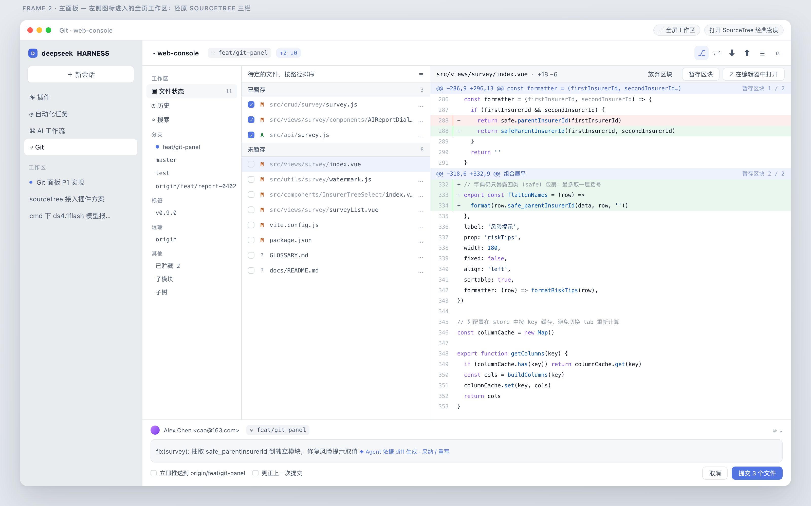

# dsh-git-tree

A DeepSeek Harness plugin that gives the Web GUI a Sourcetree-style Git workspace: a full-height panel with the left rail Sourcetree has (Working Copy / branches / tags / remotes), a staged/unstaged file list, and a diff viewer — inside DSH, next to your conversation, instead of in another app.

[中文文档](README.zh.md)



## What it does today

Version 0.2.0 is the **working slice**: it reads your working copy, stages and unstages files, and commits — inside the panel, without leaving DSH.

- **A `main` panel**, opened from the `Git` row in DSH's left icon rail — the same kind of seat the Plugins page uses, so it gets the full centre column, the window chrome inset, and DSH's theme for free.
- **Repository switcher** in the toolbar: pick any workspace registered in DSH; every route then runs against that repository.
- **Branch + sync state**: current branch, upstream, ahead/behind, repository root.
- **Sourcetree's change model**: conflict, staged and unstaged groups with counts; renames keep their original path; a file changed on both sides appears in both groups (driven by `git status --porcelain=v2 --branch -z`).
- **Structured diff**: parsed on the host into files → hunks → lines, rendered with dual line numbers, hunk headers, whole-row tints and `+N −M`.
- **Stage / unstage / commit**: per-row checkbox, hover menu, file-level action in the diff header, a commit box with author, branch, staged count and ⌘↵ — plus a `--`-guarded, conflict-checked host route for each write.
- **Live**: the panel polls status every 2s while visible and refetches immediately after a write.
- **Small write surface by construction**: file-level stage, unstage and commit only. No `reset --hard`, no push, no amend, no discard route exists.

## Status

| Area | 0.2.0 |
| --- | --- |
| `main` panel + sidebar launcher | done |
| repository switcher (DSH workspaces) | done |
| branch / ahead / behind / references rail | done |
| conflict / staged / unstaged groups | done |
| structured per-file diff | done |
| stage / unstage / commit | done |
| auto refresh | done |
| history graph | not yet |
| right-sidebar tab (compact mode) | not yet |
| large-repo virtualisation | not planned |
| agent-shared operations | not yet |

The full plan, including the measured UI spec the layout is built from, is in [`docs/PLAN.md`](docs/PLAN.md).

## Design notes

The panel copies Sourcetree's **information architecture**, not its chrome. The layout numbers are measured, not guessed: they come from the running app's accessibility tree and from decoding its Interface Builder archives — see [`docs/sourcetree-ui.md`](docs/sourcetree-ui.md) and [`docs/ib-summary.md`](docs/ib-summary.md).

Two consequences worth knowing:

- Sourcetree's diff has **no syntax highlighting**; it distinguishes lines with whole-row colour only. This panel does the same on purpose — in a diff, "which lines changed" beats "which token is a keyword".
- Every colour here is a `--dsw-alias-*` theme token, so light and dark both work without a second design. `npm test` fails if a hardcoded colour ever ships.

## How it is wired into DSH

| Half | File | What it does |
| --- | --- | --- |
| Host | `index.js` (plain ESM, no build) | registers two authenticated exact Fetch routes via `ctx.connection.fetch.register`, runs git through `ctx.subprocess` |
| Client | `client.js` (built from `src/client/index.tsx`) | registers the sidebar launcher into `sidebar.panellist` and the panel into `main`, both under the id `git-tree` |

```
GET  /api/git-tree/workspaces          → registered DSH workspaces
GET  /api/git-tree/status?cwd=…        → branch, upstream, ahead/behind, entries[], counts
GET  /api/git-tree/diff?path=…&side=…  → files → hunks → lines, stats
GET  /api/git-tree/refs?cwd=…          → branches, remotes, tags
POST /api/git-tree/stage               → { paths[] }
POST /api/git-tree/unstage             → { paths[] }
POST /api/git-tree/commit              → { message } → { sha, shortSha, subject }
```

Git runs without a shell, with `GIT_TERMINAL_PROMPT=0` (never blocks on credentials), `GIT_OPTIONAL_LOCKS=0` (never takes optional locks in your repo), `GIT_CONFIG_COUNT=0` and bounded output and time. A path that is absolute, contains `..`, or starts with `-` is refused before it reaches `argv`, and a `cwd` outside the workspace is refused with 403.

The host mechanism is documented against the installed build in [`docs/dsh-plugin-api.md`](docs/dsh-plugin-api.md) — slot ids, the Fetch-route channel, subprocess safety and theme tokens, all with `file:line` citations into `app.asar`.

## Install

From npm, by name — the package ships both halves and the bundle patch:

```sh
dsh plugin --profile <name> add dsh-git-tree
```

Or, from a session that has the plugin manager:

```
plugin_manager action=install_bundle target=dsh-git-tree
```

From this checkout:

```sh
dsh plugin --profile <name> add /Library/aiProject/dsh-git-tree
```

Restart DSH after installing: the host half is mounted at app startup. Nothing is written to your repository until you press a stage or commit control.

## Development

```sh
node build.mjs     # src/client/index.tsx → client.js (committed artifact)
npm run check      # node --check on both halves
npm test           # 40 assertions: manifest, host routes, parsers, client boot
```

`build.mjs` resolves esbuild from this package's `node_modules`, then from an installed `dsh-workbench`; if neither is present it stops with the exact command to fix that (`npm i -D esbuild`).

The test suite needs no DSH, no git and no browser:

- `test/manifest.test.mjs` — what the loader validates (platform, exports, patch row, icon, locales).
- `test/routes.test.mjs` — `apply()` against a fake context: all seven routes, the real change model, workspace switching, `--` before paths, traversal/absolute/option-shaped paths refused, commit pre-checks.
- `test/host-modules.test.mjs` — parsers as pure functions: porcelain v2 (rename/conflict/two-sided), unified diff, refs.
- `test/ui-contract.test.mjs` — the built bundle: module-loader wrapper, exactly two slot registrations under one id, routes called, theme tokens only, no `document.body`.
- `test/client-boot.test.mjs` — evaluates the built bundle in Node, materialises the plugin and calls `apply()` against a Cordis-like context that throws on undeclared services.

## Design mockups

`docs/design/` holds the four artboards the implementation is being measured against:

| File | Frame |
| --- | --- |
| [`overview.png`](docs/design/overview.png) | all four |
| [`frame1-docked.png`](docs/design/frame1-docked.png) | compact panel next to a conversation |
| [`frame2-workspace.png`](docs/design/frame2-workspace.png) | full workspace: rail / files / diff / commit box |
| [`frame3-history.png`](docs/design/frame3-history.png) | history lanes and commit detail |
| [`frame4-states.png`](docs/design/frame4-states.png) | row states, size grid, theme tokens, data flow |

## License

MIT
