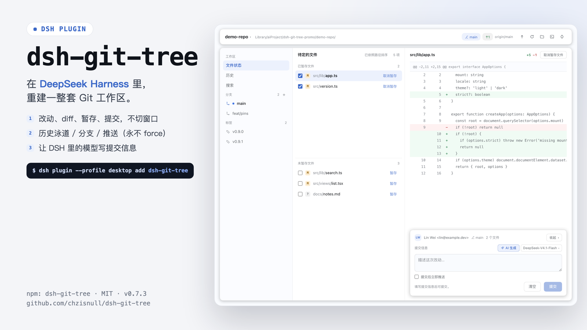
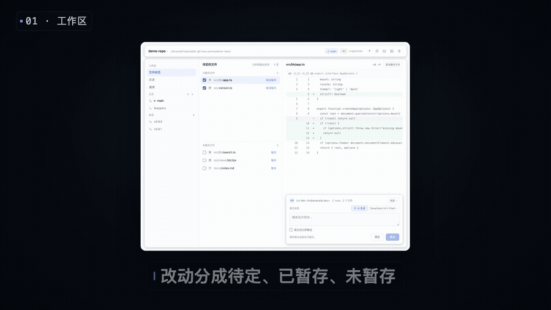

# dsh-git-tree

一个 DeepSeek Harness 插件：把 Sourcetree 那套 Git 工作区搬进 Web GUI——占满主面板的三栏布局（左侧「工作区 / 分支 / 标签 / 远端」导航、已暂存 / 未暂存文件列表、diff 视图），就在对话旁边，不用再切到另一个 App。

[English](README.md)



[](docs/media/promo.mp4)

`35 秒介绍片（mp4，3.6 MB）` · [`海报`](docs/media/poster.png)

## 0.11.0 能做什么

这一版是**本地 Git 工作台**：文件状态、历史、搜索、本地分支——读改动、暂存、提交、切分支、看任意一次提交，全在面板里完成，支持推送当前分支，也可以让 DSH 里的模型来写提交信息。fetch / pull、远程分支和远端管理还没有做。

- **一个 `main` 面板**，入口是左侧图标栏里的 `Git` 一行——和「插件」页面用的是同一类座位，所以它自动拿到整个中栏、窗口顶部安全区和 DSH 的深浅色。
- **快捷键开合**：任意位置按 `⇧⌘V`（Windows 是 `Ctrl+Shift+V`）打开面板，面板已经打开时再按一下就回到对话。命令走 DSH 自带的快捷键服务注册，所以它会出现在「设置 → 键盘快捷键」（`⌘/`）里，可以搜索、改键、恢复默认；工具栏右侧的键帽徽标和 diff 空态的提示显示的就是你当前的绑定。面板自己的确认框和 AI 冲突预览打开时不响应，避免一次误触把没保存的结果丢掉。
- **顶部仓库切换**：列出 DSH 已注册的 workspace，选中哪个，所有路由就作用在哪个仓库；仓库可以置顶（置顶区按置顶顺序在前），其余按你切换过去的次数排序、次数相同按最近一次。
- **分支与同步状态**：当前分支、upstream、ahead/behind、仓库根目录。
- **Sourcetree 的改动模型**：冲突 / 已暂存 / 未暂存三组带计数；重命名保留原路径；同一文件两侧都有改动时两栏各出现一次（数据来自 `git status --porcelain=v2 --branch -z`）。
- **结构化 diff**：宿主解析成 files → hunks → lines，渲染双行号、hunk 头、整行底色与 `+N −M`。
- **暂存 / 取消暂存 / 提交**：行内复选框、悬停菜单、diff 头部文件级动作，底部提交区（作者、分支、暂存数、⌘↵）。
- **历史视图**：提交泳道图 + 描述 / 短 SHA / 作者 / 日期，「所有分支 / 仅当前分支」过滤，每页 200 条分页加载。
- **提交详情**：选中提交看信息、作者、日期、父级、refs 与变更文件；点文件看该提交内 diff；父级链接可跳转。
- **搜索视图**：按提交信息 / 作者 / 文件路径搜提交，结果复用历史列表与详情。
- **分支**：单击看该分支历史、双击检出；可新建 / 重命名 / 删除本地分支；脏工作区检出会被拒绝，不会自动 stash。
- **右键操作**：改动行可提交（暂存并聚焦提交框）、暂存/取消暂存、放弃更改、删除文件 / 删除未跟踪文件、复制路径；分支行可检出、重命名、删除、复制名称；提交行可复制 SHA、从此提交新建分支、复制提交信息。危险操作先确认，只有可执行的破坏项是红色。
- **获取 / 拉取**：获取只更新远端跟踪引用（带 `--prune`），让 ahead/behind 是新鲜的；拉取把当前分支快进到 upstream，没有 upstream 时走 `origin/<同名分支>`。两个动作分开，面板打开时静默获取一次；本地与远端分叉时先确认，同意后才把远端合并进来，冲突落到冲突视图。
- **推送**：把当前分支推到它的 upstream（首次推送自动建立跟踪）。永不 force；认证失败和非快进会被翻译成可读的下一步提示。
- **提交并推送**：提交卡片里的复选框，提交成功后立即推送；推送失败不会回滚提交。
- **提交区可折叠**：折叠后只剩一条——作者、分支、暂存数、提交信息首行——把空间还给 diff。两种状态下右上角都是带文字的「收起 / 展开」按钮，点这条也能切换；折叠状态跨刷新记住，改动行右键「提交…」时会先自动展开并聚焦输入框。
- **冲突视图 + AI 解决冲突**：冲突文件右侧显示工作区里带 `<<<<<<<` 标记的内容（ours 蓝色、theirs 琥珀色逐行高亮），不再是「该文件没有差异」；「AI 解决」让当前模型合并这一个文件，结果以 diff 预览，点「应用」才写盘。写盘后可一键「还原冲突」（`git checkout --merge`），「标记为已解决」（`git add`）是单独的、需要你点的步骤——应用不会自动暂存。
- **AI 生成提交信息**：提交卡片里的 ✨ 按钮，按这次提交会包含的文件（有暂存就用暂存，没有就用全部改动）的 diff 生成提交信息；旁边的模型按钮从 DSH 的实时模型列表（所有已注册提供方，分组展示）里挑模型。选择按 DSH home 记住，调用本身走 DSH 自己的 `llm` 服务，插件里不另配一套 provider。它只把文字填进输入框——仍然由你检查、点提交。所选文件的 diff 会发给你选中的模型。
- **本地动作**：在 Finder 中显示、在终端打开（macOS）。
- **实时**：面板可见时每 2 秒刷新，写操作后立即刷新。
- **写操作面很小**：stage / unstage / commit、放弃更改、删除、分支新建-重命名-删除、检出、合并到当前分支，以及一个永不 force 的当前分支推送。没有 `reset --hard`、没有 force push、没有 amend、没有 rebase、没有 stash 路由。

## 状态

| 能力 | 0.11.0 |
| --- | --- |
| `main` 面板 + 侧栏入口 | 已完成 |
| 快捷键（`⇧⌘V`） | 已完成 |
| 仓库切换（DSH workspaces） | 已完成 |
| 分支 / ahead / behind / 引用树 | 已完成 |
| 冲突 / 已暂存 / 未暂存分组 | 已完成 |
| 结构化单文件 diff | 已完成 |
| 暂存 / 取消暂存 / 提交 | 已完成 |
| AI 生成提交信息 + DSH 模型选择 | 已完成 |
| 历史视图（泳道 / 分页 / 过滤） | 已完成 |
| 提交详情 + 提交内 diff | 已完成 |
| 搜索（信息 / 作者 / 路径） | 已完成 |
| 分支导航 + 检出 | 已完成 |
| 分支新建 / 重命名 / 删除 | 已完成 |
| 右键操作 + 放弃更改 / 删除文件 | 已完成 |
| 推送 / 提交并推送 | 已完成 |
| 冲突视图 + AI 解决冲突 | 已完成 |
| Finder / 终端 | 已完成 |
| 自动刷新 | 已完成 |
| 推送当前分支 | 已完成 |
| 获取 / 拉取 | 已完成 |
| 远程分支 / 远端管理 | 未做 |
| 变基 / 贮藏 / 手工三栏合并编辑器 | 不做 |
| 大仓库虚拟滚动 | 不做（按决定取消） |
| 与 Agent 共用操作 | 未做 |

完整计划（包括布局依据的实测 UI 规格）在 [`docs/PLAN.md`](docs/PLAN.md)。

## 设计取舍

面板抄的是 Sourcetree 的**信息架构**，不是它那层皮。布局数字是量出来的，不是估的：来自运行中 App 的 Accessibility 树，以及解码它的 Interface Builder 归档——见 [`docs/sourcetree-ui.md`](docs/sourcetree-ui.md) 和 [`docs/ib-summary.md`](docs/ib-summary.md)。

两个值得一提的结论：

- Sourcetree 的 diff **没有语法高亮**，只用整行底色区分增删。这个面板刻意保持一致——diff 里「哪几行变了」比「哪个 token 是关键字」重要。
- 所有颜色都是 `--dsw-alias-*` 主题 token，深浅色不用做第二套设计。一旦有人写死颜色，`npm test` 会直接失败。

## AI 生成提交信息

提交卡片里的 ✨ 按钮和模型按钮，是一个刻意做小的功能：

- **用哪个模型**：列表来自 `ctx.llm` 的实时目录——DSH 注册的每个提供方，以及它声明的模型。和 DSH 模型选择器看到的是同一份数据，每次请求现取，所以你在 DSH 设置里新加的模型不用重开面板就能出现在这里。
- **用哪些文件**：这次提交会包含的文件的 diff——有暂存就用暂存行，没有就用工作区行。未跟踪文件只贡献路径不贡献内容（`git diff` 没有可对比的一侧）；diff 超过 24 KB 会被截断并标注。
- **会发出去什么**：文件列表和这份 diff，发给你选中的模型，每按一次发一次。没有别的——不发送提交历史、凭据或会话上下文。
- **它不做什么**：不提交、不暂存、不改文件。文字只填进输入框，由你修改或放弃。
- **选择存在哪**：`~/.dsh/git-tree/ai-settings.json`（或 `$DSH_HOME/git-tree/ai-settings.json`），由宿主半写入。没有保存过就用 DSH 默认 Agent 模型；如果那条路由已不在列表里，卡片显示「选择模型」而不是去调用一条坏路由。
- **失败会明说**：缺凭据、限流、模型想调用工具、空回复、超时，各自返回自己的提示，而不是一句笼统的错误。

## 在 DSH 里怎么接

| 半边 | 文件 | 作用 |
| --- | --- | --- |
| Host | `index.js`（纯 ESM，无构建） | 用 `ctx.connection.fetch.register` 注册一组带鉴权的 exact Fetch 路由（见下），用 `ctx.subprocess` 跑 git，用 `ctx.llm` 生成提交信息 |
| Client | `client.js`（由 `src/client/index.tsx` 构建） | 把侧栏图标注册进 `sidebar.panellist`、面板注册进 `main`（共用 id `git-tree`），并用 `ctx.shortcuts` 注册 `panel.git-tree.toggle` |

```
GET  /api/git-tree/workspaces          → DSH 已注册 workspace（带置顶与打开次数，已排好序）
POST /api/git-tree/repositories/pin    → { path, pinned } → 置顶 / 取消置顶
POST /api/git-tree/repositories/open   → { path } → 记录一次主动切换
GET  /api/git-tree/status?cwd=…        → 分支、upstream、ahead/behind、entries、counts
GET  /api/git-tree/diff?path=…&side=…  → files → hunks → lines、统计（或 commit=<sha>）
GET  /api/git-tree/refs?cwd=…          → 本地分支、标签
GET  /api/git-tree/history?scope=…     → 带泳道的提交、分页、过滤
GET  /api/git-tree/commit-info?sha=…   → 元信息、父级、refs、变更文件
GET  /api/git-tree/ai/models           → DSH 模型目录 + 已保存/默认路由
POST /api/git-tree/stage               → { paths[] }
POST /api/git-tree/unstage             → { paths[] }
POST /api/git-tree/commit              → { message } → { sha, shortSha, subject }
POST /api/git-tree/commit-message      → { side, files[] } → { message }（一次模型调用）
POST /api/git-tree/conflict/resolve    → { path } → { content, diff }（只预览，不写盘）
POST /api/git-tree/conflict/apply      → { path, content } → 写入工作区文件
POST /api/git-tree/conflict/revert     → { path } → git checkout --merge
POST /api/git-tree/conflict/mark-resolved → { path } → git add（有标记时拒绝）
POST /api/git-tree/ai/model            → { provider, model } → 记住选择
POST /api/git-tree/checkout            → { branch } → 脏工作区拒绝
POST /api/git-tree/branch/create|rename|delete
POST /api/git-tree/open                → { target: 'finder' | 'terminal' }
POST /api/git-tree/push                → 当前分支 → 它的 upstream（永不 force）
POST /api/git-tree/fetch               → git fetch <remote> --prune（不动工作区）
POST /api/git-tree/pull                → { mode: 'ff-only' | 'merge' } → 先获取再快进
POST /api/git-tree/discard             → { paths[], side } → git restore
POST /api/git-tree/remove              → { paths[], untracked } → git rm / git clean
```

git 不走 shell；子进程环境带 `GIT_TERMINAL_PROMPT=0`（永不卡在认证）、`GIT_OPTIONAL_LOCKS=0`（不在你的仓库里拿可选锁）、`GIT_CONFIG_COUNT=0`，输出与耗时都有上限。绝对路径、含 `..`、以 `-` 开头的路径在进入 `argv` 之前就被拒绝；工作区之外的 `cwd` 一律 403。

宿主机制的取证（slot id、Fetch 路由通道、subprocess 安全、主题 token）都在 [`docs/dsh-plugin-api.md`](docs/dsh-plugin-api.md)，每条都带 `app.asar` 内的 `file:line` 引用。

## 安装

从 npm 按名称安装（包里同时带宿主半、客户端半和 bundle patch）：

```sh
dsh plugin --profile <profile> add dsh-git-tree
```

或者在带 plugin manager 的会话里：

```
plugin_manager action=install_bundle target=dsh-git-tree
```

从本地检出安装：

```sh
dsh plugin --profile <profile> add /Library/aiProject/dsh-git-tree
```

装完要**重启 DSH**（宿主半在 App 启动时装配）。在你的按下暂存或提交之前，插件不会写你的仓库。

## 开发

```sh
node build.mjs     # src/client/index.tsx → client.js（产物入库）
npm run check      # 两个半边 node --check
npm test           # 78 条断言：清单、宿主路由、解析器、客户端启动、导入守卫
```

`build.mjs` 先找本包的 `node_modules` 里的 esbuild，再找已安装的 `dsh-workbench`；都没有就停下并打印修复命令（`npm i -D esbuild`）。

测试不需要 DSH、不需要 git、不需要浏览器：

- `test/manifest.test.mjs` —— 加载器会校验的东西（platform、exports、patch 行、图标、语言包）。
- `test/routes.test.mjs` —— 用假 context 跑 `apply()`：七条路由、真实改动模型、仓库切换、路径前有 `--`、穿越/绝对/选项形路径被拒、提交前检查。
- `test/host-modules.test.mjs` —— 解析器作为纯函数：porcelain v2（rename / 冲突 / 双侧）、unified diff、refs。
- `test/ui-contract.test.mjs` —— 构建产物：loader 包装、恰好两次 slot 注册且共用 id、调用路由、只用主题 token、不碰 `document.body`。
- `test/client-boot.test.mjs` —— 在 Node 里执行构建产物、物化插件，用「未声明服务即抛错」的 Cortis 式 ctx 调 `apply()`。

## 介绍片与海报

`docs/media/` 里是这套宣传素材：介绍短片、本页用的无声循环、竖版海报和横版头图。

| 文件 | 内容 |
| --- | --- |
| [`promo.mp4`](docs/media/promo.mp4) | 35 秒介绍片（1920×1080，H.264，3.6 MB） |
| [`promo-loop.gif`](docs/media/promo-loop.gif) | 上方那张 6 秒无声循环（900 px 宽） |
| [`poster.png`](docs/media/poster.png) | 竖版海报 1782×2353 |
| [`cover.png`](docs/media/cover.png) | 横版头图 1600×900 |

片子与图片都取自真实面板，演示仓库是虚构的 `aurora-notes`（作者 `Lin Wei <lin@example.dev>`）；安装段是在一次性 DSH profile 里对已发布包做的真实安装。

`docs/design/` 里是实现对照的四张画板：

| 文件 | 内容 |
| --- | --- |
| [`overview.png`](docs/design/overview.png) | 四张总览 |
| [`frame1-docked.png`](docs/design/frame1-docked.png) | 对话旁边的窄面板形态 |
| [`frame2-workspace.png`](docs/design/frame2-workspace.png) | 全页工作区：导航 / 文件 / diff / 提交区 |
| [`frame3-history.png`](docs/design/frame3-history.png) | 历史泳道与提交详情 |
| [`frame4-states.png`](docs/design/frame4-states.png) | 行状态、尺寸栅格、主题 token、数据流 |

## 许可

MIT
